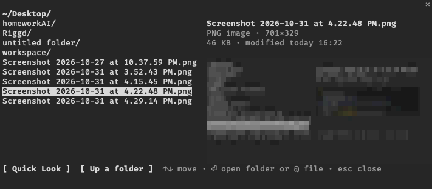

# file-peek

A file picker for Claude Code's `@` mentions that shows what you are about to attach. Arrow through a folder and the panel beside the list describes the highlighted entry: a thumbnail and dimensions for images, page count for PDFs, line count and the first lines for text files, item count for folders, and git state for anything in a repository. Press `p` to open it in macOS Quick Look, Enter to drop it into your prompt as an `@` mention.



The thumbnail is drawn with coloured quadrant block characters, so it works in any terminal with true colour, including inside multiplexers such as tmux or herdr. It is a preview, not a full picture: use Quick Look for the real image.

## Install

At the prompt of a Claude Code terminal session:

```
/plugin install file-peek --marketplace maxlibin/claude-file-peek
```

Answer `y` to add the marketplace, then pick a scope (user is the first one).

From a shell:

```
claude plugin install file-peek --marketplace maxlibin/claude-file-peek
```

Requires macOS: the info panel uses `sips`, `file`, `mdls` and `qlmanage`, all built in.

## Use

- Type an `@` path, e.g. `@~/Desktop/`, then `?` to open the picker on that folder. Your draft is kept and the chosen file replaces the mention.
- Or run `/peek` (current folder) or `/peek ~/Downloads` from an empty prompt.

| Key | Does |
|---|---|
| ↑ ↓ | move the highlight; the info panel follows |
| Enter | open a folder, or insert the file as an `@` mention |
| `p` | Quick Look the highlighted file |
| `u` | up a folder |
| Esc | close and put your draft back |

## License

MIT
